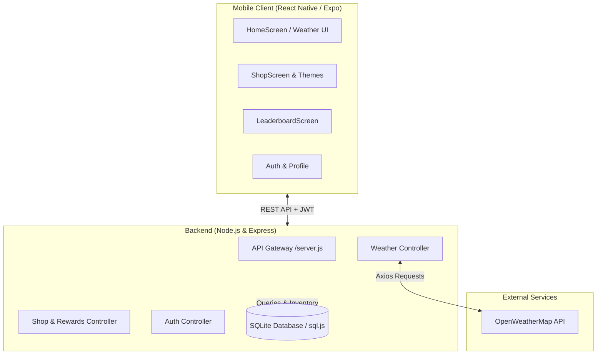

# Weathering Waves — Weather Mobile App with Reward System

<p align="center">
  
  
  
  
  
  
  
</p>

A cross-platform mobile application built with **React Native (Expo)** and **Node.js (Express)** that blends live meteorological forecasts with an engaging **gamified reward and customization system**. Users earn reward coins by checking daily forecasts and maintaining weather streaks, which they can spend in the in-app shop to unlock custom themes and fonts.

---

## Features

- **Real-Time Weather Intelligence**:
  - Live local weather powered by **OpenWeatherMap API**.
  - Automatic GPS geolocation detection using `expo-location`.
  - Multi-day forecasts, temperature, humidity, wind speed, pressure, and weather descriptions.
  - Dynamic gradient backgrounds responsive to weather conditions.
- **Gamified Reward System**:
  - Daily check-in coins and weather lookup streak rewards.
  - Animated reward claim modals on milestone achievements.
- **In-App Customization Shop**:
  - Spend earned reward points to unlock unique visual styles:
    - **Themes**: *Royal Purple (Default)*, *Ocean Depth*, *Sunset Vibes*, *Mystic Forest*, and *Midnight Gold*.
    - **Typography**: *System Default*, *Classic Serif*, and *Coder Mono*.
  - Instant theme application through React context (`ThemeContext`).
- **Community Leaderboard**:
  - Real-time ranking of top weather checkers based on points and active streak length.
- **Secure Authentication**:
  - JWT-based authentication with `AsyncStorage` session persistence.
  - Secure password hashing with `bcryptjs`.
- **Admin Dashboard**:
  - Administrative management for users, reward adjustments, and server monitoring.

---

## System Architecture



---

## Project Structure

```text
Weathering Waves/
├── backend/
│   ├── config/                # Database initialization (sql.js / SQLite)
│   ├── controllers/           # Route handlers (auth, weather, shop, admin)
│   ├── data/                  # SQLite storage file (weathering_waves.db)
│   ├── middleware/            # JWT authentication & admin authorization
│   ├── models/                # User & inventory data models
│   ├── routes/                # Express API routes (/auth, /weather, /shop, /admin)
│   ├── .env.example           # Backend environment configuration template
│   ├── package.json           # Backend dependencies & scripts
│   └── server.js              # Express app entrypoint
├── mobile/
│   ├── assets/                # App icons, splash screens, and images
│   ├── src/
│   │   ├── components/        # UI components (WeatherCard, ForecastCard, RewardModal)
│   │   ├── context/           # React context providers (AuthContext, ThemeContext)
│   │   ├── screens/           # Views (Home, Shop, Leaderboard, Login, Register, Admin)
│   │   ├── services/          # Axios API client modules
│   │   └── styles/            # Theme constants and color palettes
│   ├── App.js                 # Navigation container & root provider
│   ├── app.json               # Expo configuration
│   └── package.json           # Mobile dependencies & scripts
├── .gitignore                 # Project ignore rules
└── README.md                  # Project documentation
```

---

## API Endpoints Reference

| Method | Endpoint | Auth Required | Description |
| :--- | :--- | :---: | :--- |
| `GET` | `/api/health` | No | Server status & health check |
| `POST` | `/api/auth/register` | No | Register a new user |
| `POST` | `/api/auth/login` | No | Authenticate user & return JWT |
| `GET` | `/api/auth/me` | Yes | Retrieve user profile & current coin balance |
| `GET` | `/api/weather/current` | Yes | Get current weather by city or GPS coordinates |
| `GET` | `/api/weather/forecast` | Yes | Get 5-day weather forecast |
| `POST` | `/api/weather/reward` | Yes | Claim daily check-in or streak reward |
| `GET` | `/api/shop/items` | Yes | Retrieve available themes, fonts, and user inventory |
| `POST` | `/api/shop/purchase` | Yes | Buy a theme or font using earned reward coins |
| `POST` | `/api/shop/equip` | Yes | Equip an owned theme or font |
| `GET` | `/api/shop/leaderboard` | Yes | Retrieve global user rankings |
| `GET` | `/api/admin/users` | Admin | List all registered users (Admin only) |

---

## Getting Started

### Prerequisites

- [Node.js (v18+)](https://nodejs.org/)
- [npm](https://www.npmjs.com/) or [yarn](https://yarnpkg.com/)
- [Expo Go app](https://expo.dev/go) installed on your physical mobile device (iOS/Android) or an emulator.
- An [OpenWeatherMap API Key](https://openweathermap.org/api) (Free Tier).

---

### 1. Backend Setup

1. **Navigate to the backend directory**:
   ```bash
   cd backend
   ```

2. **Install dependencies**:
   ```bash
   npm install
   ```

3. **Configure environment variables**:
   Create a `.env` file based on `.env.example`:
   ```bash
   cp .env.example .env
   ```
   Edit `.env` and set your credentials:
   ```env
   PORT=5000
   JWT_SECRET=your_jwt_secret_key_here
   OPENWEATHER_API_KEY=your_openweather_api_key_here
   ```

4. **Start the backend server**:
   ```bash
   npm start
   # Or for development with live reload:
   npm run dev
   ```
   The API will listen at `http://localhost:5000`.

---

### 2. Mobile App Setup

1. **Navigate to the mobile directory**:
   ```bash
   cd mobile
   ```

2. **Install dependencies**:
   ```bash
   npm install
   ```

3. **Set backend API address**:
   Open [`mobile/src/services/api.js`](mobile/src/services/api.js) and update `API_BASE_URL` with your computer's local Wi-Fi IP address (e.g., `http://192.168.1.X:5000/api`) so physical devices on the same network can communicate with the backend.

4. **Launch the Expo development server**:
   ```bash
   npx expo start
   ```

5. **Run the app**:
   - **On Android/iOS**: Scan the displayed QR code with the **Expo Go** app or camera.
   - **On Web**: Press `w` in the terminal to view in your web browser.
   - **On Android Emulator**: Press `a`.
   - **On iOS Simulator**: Press `i`.

---

## Customization Shop Catalog

| Item Name | Type | Price (Coins) | Description |
| :--- | :---: | :---: | :--- |
| **Royal Purple** | Theme | 0 (Free) | Default royal purple & violet gradient |
| **Ocean Depth** | Theme | 20 | Deep sea blue and cyan gradient |
| **Sunset Vibes** | Theme | 30 | Warm twilight orange and magenta gradient |
| **Mystic Forest** | Theme | 40 | Lush emerald green and mint gradient |
| **Midnight Gold** | Theme | 50 | Dark midnight and deep indigo gradient |
| **System Default** | Font | 0 (Free) | Native platform sans-serif |
| **Classic Serif** | Font | 15 | Elegant editorial serif typography |
| **Coder Mono** | Font | 15 | Monospace terminal-style font |

---

## Contributing

Contributions, issues, and feature suggestions are welcome!

1. Fork the Project
2. Create your Feature Branch (`git checkout -b feature/NewFeature`)
3. Commit your Changes (`git commit -m 'Add NewFeature'`)
4. Push to the Branch (`git push origin feature/NewFeature`)
5. Open a Pull Request

---

## License

This project is licensed under the [MIT License](LICENSE).
